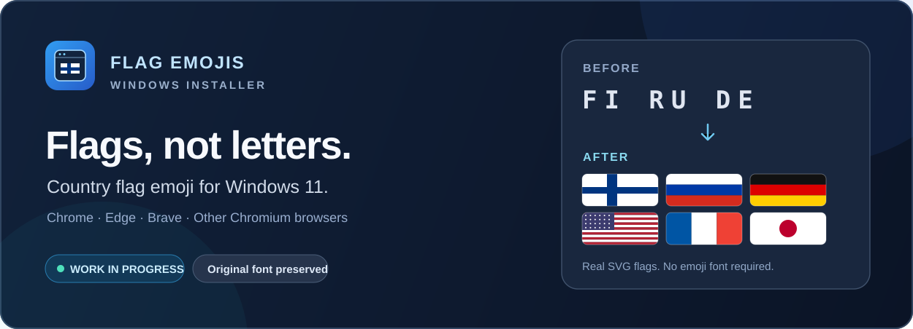

**Русский** · [English](README_EN.md)

<h1>Flag Emojis Windows Installer</h1>

### Флаги стран в Windows 11 и Chrome. Вместо буквенных обозначений.

**Один установщик · Оригинальные эмодзи Windows сохраняются · Безопасный откат**

[Установка](#installation) · [Статус проекта](#status) · [Поддержать разработку](docs/SUPPORT.md) · [Ошибки](https://github.com/xPROMSx/flag-emojis-windows-installer/issues)

> **Проект в разработке.** Готового EXE-установщика пока нет. Не скачивайте и не запускайте файлы, выдающие себя за официальный релиз этого проекта.

## ✨ Зачем нужен установщик

Windows не показывает большинство флагов стран как цветные эмодзи: вместо 🇫🇮 и 🇩🇪 в Chrome могут появляться буквенные обозначения `FI` и `DE`. Сторонний шрифт решает проблему, но обычная установка Windows не всегда переключает основной emoji-шрифт для Chromium.

**Flag Emojis Windows Installer** разрабатывается как простой способ установить поддержку флагов и при необходимости вернуть исходный шрифт Microsoft, без команд PowerShell и ручного изменения реестра.

## ⚙️ Что планируется

- **Установка в несколько кликов.** Один EXE, запрос прав администратора и понятный результат.
- **Корректная регистрация.** Проверка системного `Segoe UI Emoji (TrueType)` и переключение на установленный шрифт с флагами.
- **Сохранение оригинала.** Системный `seguiemj.ttf` не перезаписывается и не удаляется.
- **Повторный запуск и удаление.** Проверка текущего состояния, обновление только собственных файлов и восстановление исходных настроек.
- **Проверка целостности.** Загрузка закреплённой версии шрифта с проверкой SHA-256; без запуска удалённых скриптов.
- **Без фоновых служб.** Без автозапуска, телеметрии и принудительного обновления.

## 🚀 Установка

Установщик **ещё не опубликован**. Когда первая версия пройдёт проверки, готовый файл появится в [GitHub Releases](https://github.com/xPROMSx/flag-emojis-windows-installer/releases).

Планируемый сценарий: скачать EXE, запустить, подтвердить запрос Windows и перезагрузить компьютер. Удаление должно восстанавливать прежний выбор шрифта.

## 🛠️ Статус разработки

| Компонент | Состояние |
| --- | --- |
| Оформление и структура репозитория | Подготовка |
| Установка и повторный запуск | Не реализовано |
| Удаление и откат | Не реализовано |
| Автоматическая сборка EXE | Не настроена |
| Проверка на Windows 11 / Chrome | Не проводилась для этого установщика |

Пока не будут проверены установка, повторный запуск, сбой загрузки, удаление и откат, проект не будет объявляться готовым к использованию.

## 📚 Технические сведения

Первая версия ориентирована на **Windows 11** и браузеры на основе Chromium. Для установки системного шрифта потребуются права администратора и перезагрузка.

Этот репозиторий посвящён **установщику**, а не разработке новых эмодзи или сборке файла шрифта. Исходный проект шрифта, условия использования и обязательные уведомления об авторстве указаны в [NOTICE.md](NOTICE.md).

**Лицензия кода:** [MIT](LICENSE). Права на компоненты шрифта рассматриваются отдельно от лицензии установщика.

## 💬 Обратная связь

Об ошибках и предложениях сообщайте через [GitHub Issues](https://github.com/xPROMSx/flag-emojis-windows-installer/issues). До появления тестируемого EXE не публикуйте сообщения об успешной установке: готового установщика ещё нет.

---

## ❤️ Поддержать разработку

Если проект оказался полезен, вы можете добровольно [поддержать его разработку](docs/SUPPORT.md). Проект и все его функции остаются бесплатными и открытыми независимо от пожертвований.

**Флаги стран в Windows и Chrome. Просто и без лишних настроек.**

⭐ Если проект вам интересен, [поставьте Star](https://github.com/xPROMSx/flag-emojis-windows-installer). Это поможет другим найти проект.

[Установка](#installation) · [Релизы](https://github.com/xPROMSx/flag-emojis-windows-installer/releases) · [Ошибки](https://github.com/xPROMSx/flag-emojis-windows-installer/issues)

